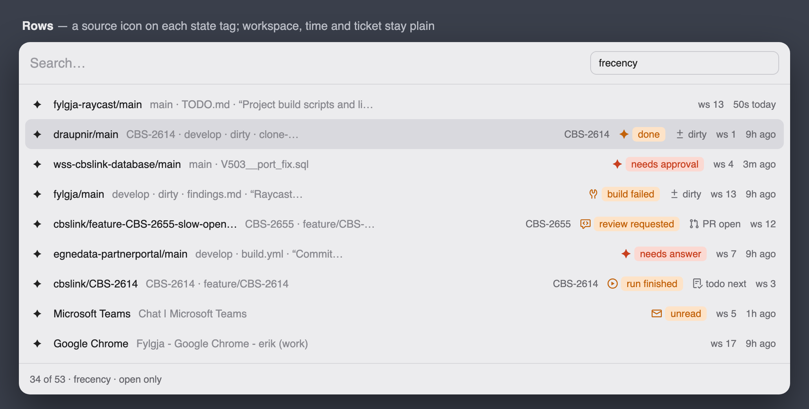
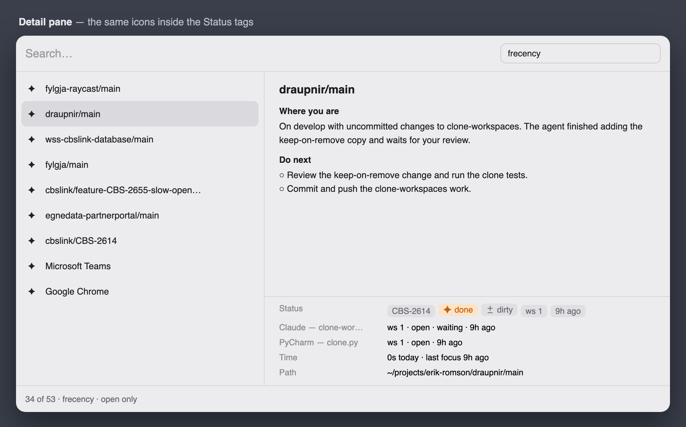

# TODO

## Open questions from first use

- [ ] "Here now" (open question 4 in the brief): the `frecency` ranker moves the item you are in down the list. When you
      switch, does the top of the list point to where you want to go?
- [ ] Is the item's `summary` a good enough subtitle, or should the daemon send a short headline?
- [ ] "Only items with something open" is on by default. Does it hide work you wanted to find by searching?

## Publish to the Raycast Store (not planned)

The extension is for private use. If that changes, do these steps. Raycast's guide is at
https://developers.raycast.com/basics/prepare-an-extension-for-store.

- [ ] Set `author` in `package.json` to a real Raycast username (Raycast → Settings → Account). `erikromson` is not one,
      so `npm run lint` (`ray lint`) fails on it.
- [ ] Update `@raycast/api` to the latest version.
- [ ] Run `npm run lint` until it passes. It checks the manifest, icons, ESLint and Prettier.
- [ ] Add `CHANGELOG.md` at the root with `## [Initial Version] - {PR_MERGE_DATE}` and a short description.
- [ ] Add store screenshots (PNG) to a top-level `metadata/` folder.
- [ ] Rewrite `README.md` for store users. It must explain that the extension needs a running Fylgja daemon and the API
      secret file, and where to get them. Reviewers may reject an extension that depends on a private daemon.
- [ ] Read the extension guidelines (https://manual.raycast.com/extensions-guidelines) and check the extension against
      them.
- [ ] Decide what to strip for the `raycast/extensions` monorepo: the husky `prepare` script, the `lint-staged` config,
      `.github/` and the live tests.
- [ ] Run `npm run build`, open the distribution build in Raycast and check that it works.
- [ ] Add `"publish": "npx @raycast/api@latest publish"` to the scripts and run `npm run publish`. It opens a pull
      request against `raycast/extensions`.

## Mockups

The status tag icons, drawn before they were built. Raycast's own icons are drawn with the closest Octicon, so they look
a little different in Raycast.

